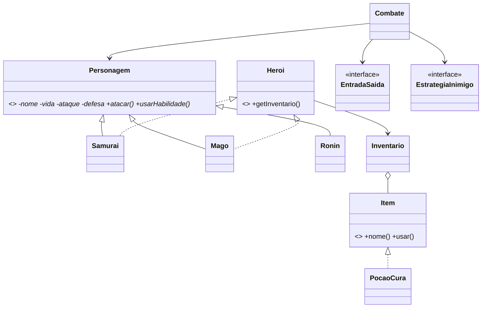

# Caminho do Guerreiro

RPG de console em Java 17 com dois heróis (`Samurai` e `Mago`) e o inimigo `Ronin`.

## Executar

```bash
mvn compile exec:java
```

Sem Maven:

```bash
javac -d out src/main/java/br/edu/rpg/*.java
java -cp out br.edu.rpg.Main
```

## Mecânicas

- Combate em turnos: ataque, habilidade especial e poção.
- Samurai: 130 de vida, Corte da Lua.
- Mago: 90 de vida, mana e Bola de Fogo.
- Ronin: 150 de vida e chance de usar Golpe Desonrado.
- Inventário básico com Poção de Cura.

## SOLID

- **SRP:** `Combate` coordena a batalha, `Inventario` gerencia itens e `ConsoleEntradaSaida` cuida do terminal.
- **OCP:** novos personagens podem estender `Personagem`; novos itens implementam `Item`.
- **LSP:** `Samurai`, `Mago` e `Ronin` podem substituir `Personagem` no combate.
- **ISP:** interfaces pequenas: `Heroi`, `Item`, `EntradaSaida` e `EstrategiaInimigo`.
- **DIP:** `Combate` depende das abstrações `EntradaSaida` e `EstrategiaInimigo`, recebidas pelo construtor.

## UML


